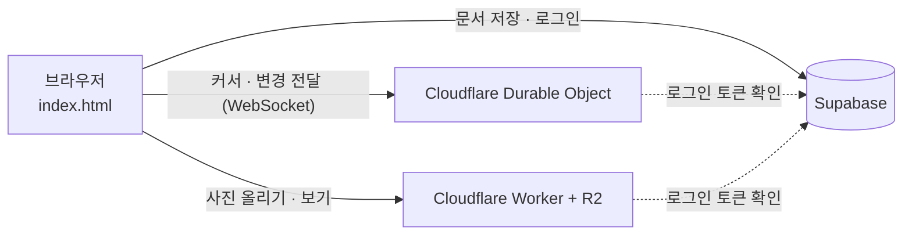

# 인물 관계도 (relmap)

브라우저에서 **인물·관계(화살표)·그룹**을 그리는 관계도 편집기입니다. 영화·드라마 같은 작품 속 인물 관계를 정리하고, 여러 명이 같은 방에서 **실시간으로 함께 편집**할 수 있어요. 빌드 도구 없이 `index.html` 파일 하나로 돌아갑니다.

## 주요 기능

**그리기와 편집**
- 인물(아이콘·이름·설명·사진), 관계선(방향·라벨·색), 글자 상자, 그룹 원(그룹 안에 더 작은 그룹도 가능, 배경 이미지 지정)
- 편집 모드에서 빈 곳을 끌어 사각형으로 여러 개 선택, 함께 이동·삭제, 실행 취소·다시 실행
- 검색(인물·그룹·작품 이름), 라이트·다크·시스템 화면 모드

**읽기 모드와 스포일러 방지**
- 기본은 읽기 모드: 인물을 끌면 줄이 늘어났다가 제자리로 돌아오는 탄성 움직임, 인물을 누르면 프로필 창
- 작품(영화·드라마·에피소드)과 카테고리를 만들고 인물·관계선에 "등장 작품"을 붙이면, 내가 **본 작품만** 체크했을 때 안 본 작품에 관한 인물·관계·설명이 숨겨져요(보는 사람 브라우저에만 저장)
- 인물마다 작품별 사진 버전, 시청에 따라 보이는 추가 설명, 3~12각형 스탯

**공동 편집과 저장**
- 공동 편집: 링크를 복사해 같은 방에 들어오면 서로의 수정·커서가 바로 보여요(방 주소가 곧 열쇠)
- 혼자 쓸 때는 서버 없이 JSON 파일로 저장·불러오기
- 로그인(이메일·Google)하면 내 관계도를 서버에 저장하고, 백업 파일·읽기 전용 감상용 파일을 받을 수 있어요. 자동 백업(최근 5개)도 브라우저에 보관합니다.

## 구조



- **앱**: `index.html` 하나(HTML+CSS+JS). 정적 파일이라 Cloudflare Pages 같은 곳에 그대로 올리면 됩니다.
- **Supabase**: 문서 저장(Postgres + RLS + SQL 함수)과 로그인(익명·이메일·Google). 스키마는 [`supabase_schema.sql`](supabase_schema.sql).
- **사진 서버(선택)**: 사진을 DB 대신 Cloudflare R2에 두고 문서에는 주소만 넣어 Supabase 전송량을 아낍니다. → [`worker/`](worker/README.md)
- **실시간 중계(선택)**: 커서·접속자·변경 전달만 Durable Object가 맡아 Supabase 실시간 메시지 한도를 피합니다. → [`worker/`](worker/README.md)
- 선택 항목을 안 켜면 Supabase만으로 동작합니다.

## 시작하기

서버 설정 없이도 **혼자 쓰기(그리기·JSON 저장/불러오기)** 는 바로 됩니다.

```sh
git clone https://github.com/Someone11155/Relmap.git
cd Relmap
python -m http.server 8000
```

브라우저에서 `http://localhost:8000/index.html` 을 엽니다. 처음엔 읽기 모드라서 위쪽의 **편집** 버튼을 눌러야 그릴 수 있어요.

**공동 편집·로그인·배포**를 쓰려면 Supabase 프로젝트가 필요합니다. 순서는 [`SETUP.md`](SETUP.md)에 있어요.

1. Supabase 만들기 → `supabase_schema.sql` 실행 → 익명 로그인 켜기
2. `config.js`에 프로젝트 URL과 publishable 키 넣기(공개돼도 되는 값만, secret 키는 절대 금지)
3. Cloudflare Pages 등에 `index.html` + `config.js` 올리기
4. (선택) 사진 서버·실시간 중계 서버 배포 → [`worker/README.md`](worker/README.md)

## 폴더

| 경로 | 내용 |
|---|---|
| `index.html` | 앱 전부 |
| `config.js` | 서버 주소·키 설정 템플릿(값은 비어 있음) |
| `supabase_schema.sql` | Supabase 스키마와 함수 |
| `worker/` | 사진 서버(R2)와 실시간 중계(Durable Object) |
| `dev/` | 테스트 환경 — 가짜 Supabase 서버와 Playwright 테스트 |
| `relationmap/` | Cloudflare Pages 에 올리는 배포용 폴더(`index.html` 복사본). 실제 키가 든 `config.js` 는 저장소에 없음 |
| `SETUP.md` | 설정·배포 순서(Supabase, 로그인, Pages, 사진·중계 서버) |
| `CLAUDE.md` | 코드 구조와 설계 이유 메모 |

## 테스트

진짜 Supabase 없이도 동기화·공동 편집을 확인할 수 있게, 실제 SQL 함수를 Postgres에서 그대로 돌리는 가짜 서버와 Playwright 테스트가 있습니다. 준비물과 실행법은 [`dev/README.md`](dev/README.md)를 보세요.

```sh
dev/run.sh                 # 전체
dev/run.sh collab panel    # 일부만
```

## 알아 둘 점

- **방 주소가 곧 열쇠**입니다. 주소를 아는 사람은 누구나 편집할 수 있어요(읽기 모드는 실수 방지용 잠금일 뿐 권한이 아닙니다). 믿을 만한 사람에게만 공유하세요.
- 숨겨진 인물·작품은 화면에서만 가려질 뿐, 저장 파일에는 모두 들어 있습니다(보안 기능이 아님).
- 자동 테스트는 가짜 서버로 돌립니다. 실제 Supabase·Cloudflare·모바일 기기에서의 동작은 직접 확인해야 해요.
